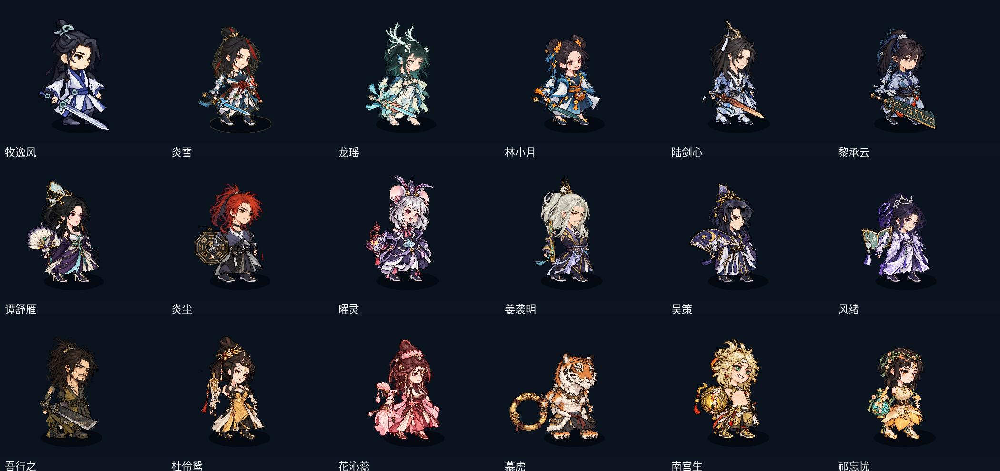
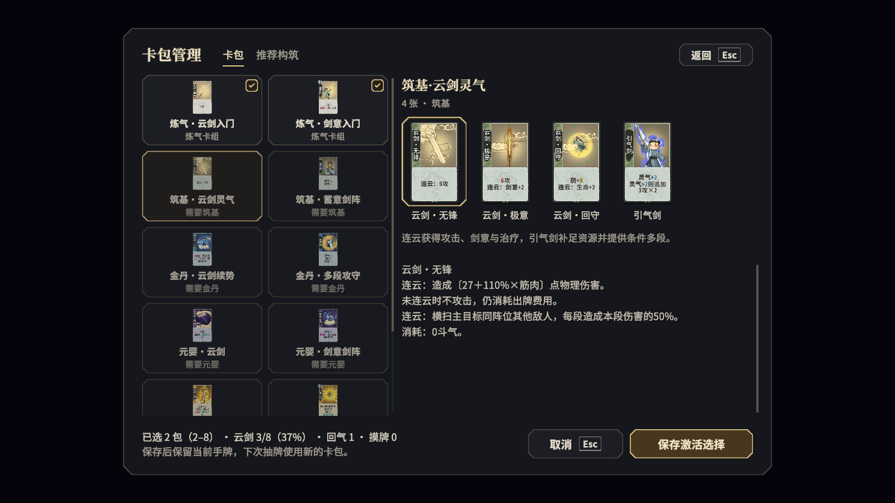
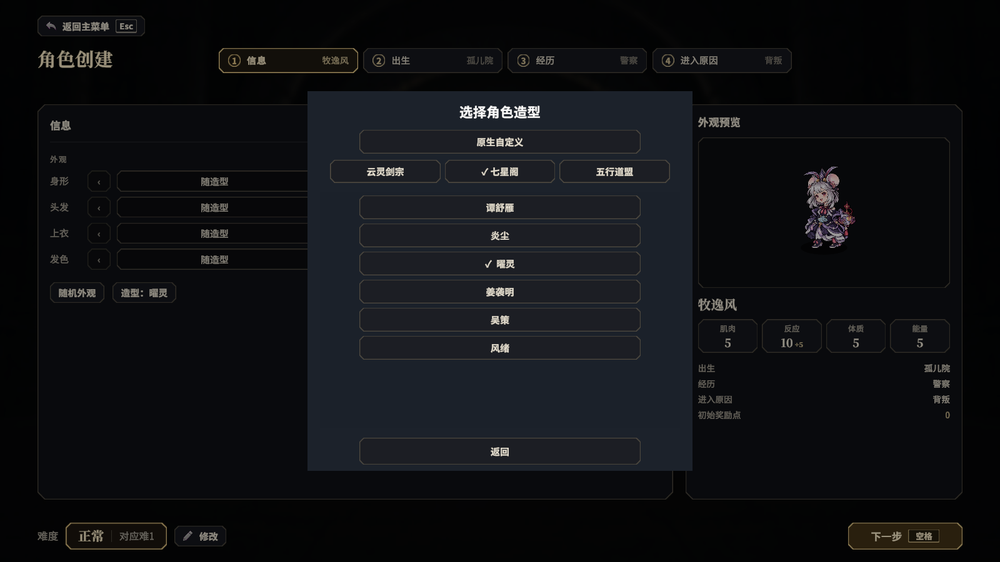

# 轮回小队 · 弈仙门派 Mod

在《轮回小队 Demo》中体验《弈仙牌》的三门派构筑，搭配 18 位角色造型。

**当前源码与本地完整包：v0.7.3** · [公开发行下载](https://github.com/codefromkarl/lunhui-xiaodui-yixian-mod/releases) · [安装位置](#安装位置) · [如何使用](#如何使用)

v0.7.3 修复左右手手型与拇指方向、陆剑心靴子比例、能力详情重复；合入灵剑转化的免费开关。首次安装与更新统一使用一个完整包。



## 门派 Mod

云灵剑宗、五行道盟、七星阁，共 **136 张卡牌、12 项仙命、五个境界**。每名角色可加入一个弈仙门派，并搭配原生血统。

从炼气到化神，解锁卡牌与仙命，在战斗中手动出牌、调整构筑。首回合发 3 张，之后每回合自动补 2 张；需要额外补牌时，可消耗 1 行动力主动摸牌。

**v0.7.1 剑宗更新**：普通单段剑招取筋肉、多段取反应，灵剑路线取能量。20点可选被动「灵剑转化」购买后默认关闭；主神空间的能力页可以免费开启／关闭，开启后实际扣除筋肉／反应／体质各60%转为能量，后续加点同样生效。[完整说明](docs/sword-scaling.md)。

各派的路线与机制：[云灵剑宗](docs/sword-builds.md) · [五行道盟](docs/five-elements.md) · [七星阁](docs/seven-stars.md)



## 外观 Mod

三门派共 **18 位可选造型**，带角色自有持物与头肩头像，只改变外观，不改装备和数值。玩法与外观是两个独立包，可以一起使用，也可只启用其中一个。

选择造型不会自动加入对应门派，角色外观和玩法路线可以自由搭配。



## 安装位置

在 Steam 库中右键《轮回小队 Demo》，选择 **属性 → 已安装文件 → 浏览**，打开游戏目录。Mod 放在这里的 `Mods/` 文件夹中，与 `ReincarnationSquad.exe` 同级：

```text
轮回小队 Demo/
├── ReincarnationSquad.exe
└── Mods/
    ├── yixian.sect/          # 门派玩法
    └── appearance.muyifeng/  # 角色外观
```

1. 正常退出游戏，解压完整包。首次安装与更新均使用它。
2. Windows 双击 **安装.bat**，Mac 双击 **安装.command**，选择含 `ReincarnationSquad.exe` 的游戏目录。安装器自动备份、替换玩法与外观并校验文件；旧包中的测试结果、历史源码与废弃资源仅保存在备份中。
3. 启动游戏，在 Mod 管理中启用「弈仙门派」与「弈仙牌 · 三门派角色外观」，按提示确认代码许可；若提示重启，正常重启。

## 如何使用

**门派玩法**：新开一局，在主神空间的角色商店选择门派入宗，使用奖励点突破境界、取得卡牌与仙命。进入战斗后，在「卡牌」页出牌，通过 **卡包管理** 调整构筑；推荐方案需要确认保存才生效。

**角色外观**：新建角色时，打开 **信息 → 造型**，选择门派，再选角色；选择「原生自定义」可恢复原生造型。目前不支持给已创建的原生角色中途换肤。

> [!IMPORTANT]
> 从旧版门派 Mod 更新时，建议新开局；旧版牌库的存档请搭配对应旧版 Mod 使用。联机玩家需安装并启用相同版本。

手动安装也可：把旧的 `yixian.sect/` 和 `appearance.muyifeng/` 移到 `Mods/` 之外备份，再把完整包里的 `Mods/` 合并到游戏目录。不要套成 `Mods/Mods/`。回退时正常退出游戏，用备份的对应目录替换新版。启用名单、代码许可和存档由游戏管理。

完整包只保留运行需要的 DLL、内容、配置和图片；开发参考图、原始图集布局、提示词、PDB、旧测试报告不会装进 `Mods/`。来源说明保留在包内 `sources/`。历史无图覆盖更新包仅供旧版追溯，当前推荐入口统一为完整包。

开发、来源与验收：[开发指南](docs/development.md) · [本轮修复记录](docs/mod-fixes-0.7.3.md) · [测试状态](docs/testing-status.md) · [第三方资源](THIRD_PARTY_ASSETS.md)。
