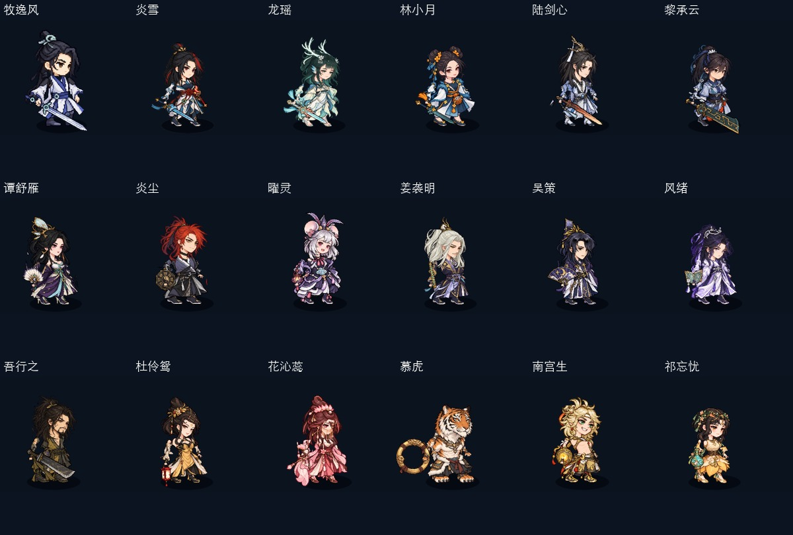

# v0.7.3 全18位外观核对

2026-10-22，Mac／Wine，真实Unity Mono。保留已发布外观0.7.2的动作、表情、灯笼与衣袖改进后，重新构建0.7.3并运行完整图形验证：548项通过、0失败，取得正常退出回执。

本轮检查覆盖所有18位角色。对全部角色逐一查看待机、攻击、镜像截图；其余移动、受击、倒地、恢复由真实动画七阶段采样核对关节、图像、身份和恢复。单独复核双手素材与原生手臂槽对应、拇指朝向、手腕和持物连接；脚踝、裤脚和足部可见像素重合；站姿足向及镜像方向；脸与领口、头肩头像和角色自身色系。

| 门派 | 已逐一核对的角色 | 结果 |
|---|---|---|
| 云灵剑宗 | 牧逸风、炎雪、龙瑶、林小月、陆剑心、黎承云 | 左右手修复适用于全部角色；陆剑心靴子单独缩小；其他角色保留各自鞋靴或赤足 |
| 七星阁 | 谭舒雁、炎尘、曜灵、姜袭明、吴策、风绪 | 手型、脚踝衔接与镜像通过，保留各自紫金、灰黑等原有衣着与足部设计 |
| 五行道盟 | 吾行之、杜伶鸳、花沁蕊、慕虎、南宫生、祁忘忧 | 手型、足部与衣袍衔接通过；保留虎爪及其他角色各自的鞋款，不统一套靴子 |

除陆剑心已调整的靴子比例外，本轮逐图核对未发现其他需要改动的足部素材与衣服搭配。548项通过包含原生动作时钟、四类持物动作、受击与倒地表情，以及全部角色的身份／头像／对象池恢复。

本机证据：`appearance-muyifeng/output/run-20261022-204533/results/`。逐角色七阶段截图、完整报告、336帧动作捕获及退出回执在该目录；人工核对用的攻击与镜像汇总位于本机 `logs/all-characters-attack.jpg`、`logs/all-characters-mirror.jpg`。这些测试使用独立副本，不接入用户战役存档。
